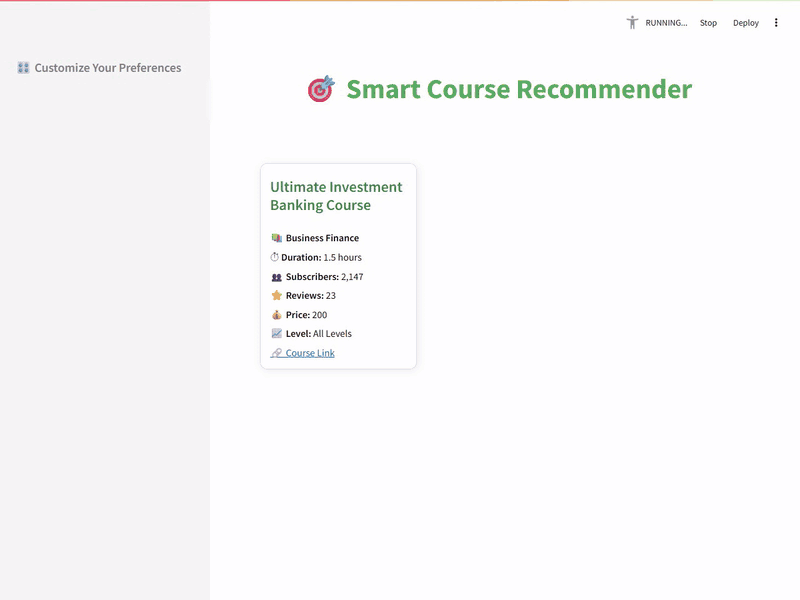
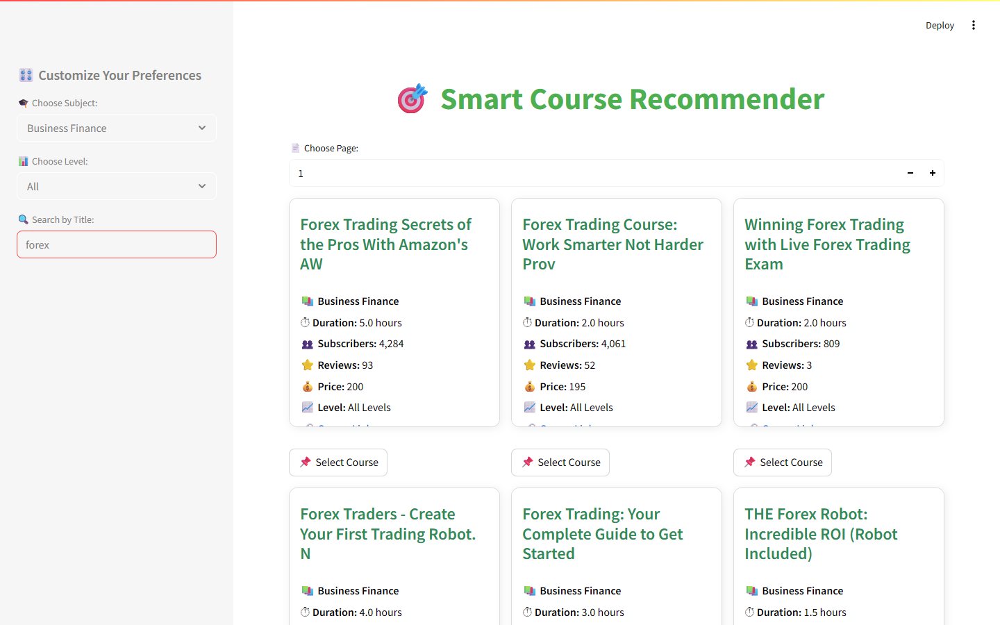
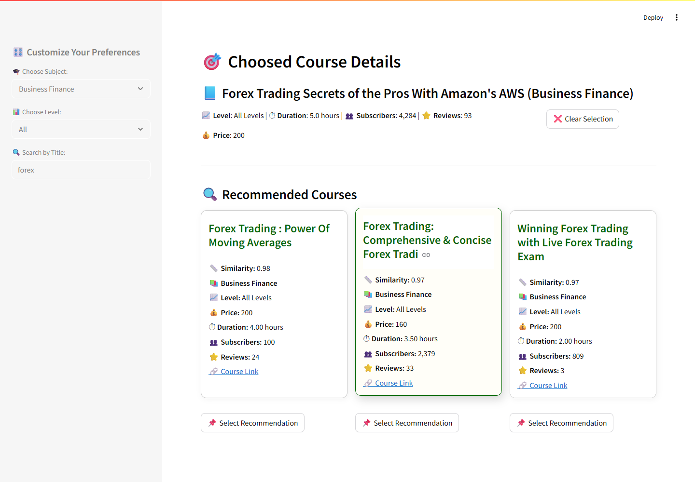

# 🎯 Smart Course Recommender

A content-based recommendation system for **Udemy courses**, built with **scikit-learn** and served through an interactive **Streamlit** web app.
Pick any course and the app suggests the 3 most similar courses. It compares their titles, subject, level, price, popularity and length.


> Built as a project at the **National Telecommunication Institute (NTI)**.

---

## 📌 Overview

Online learners face too many choices. This project helps users find **relevant, high-quality courses** quickly by answering one question:
**"I liked this course. What should I take next?"**

The system uses **content-based filtering**. It needs no user history or ratings. It describes each course by its own attributes and recommends the courses closest to it, measured with **cosine similarity**.

## 🎬 Demo

In this demo, the user filters by **Musical Instruments**, searches for **"guitar"** and selects *Your First 10 Guitar Lessons*. The app recommends three beginner guitar courses (similarity ≈ 0.96). Selecting one of them gives a new set of recommendations.



> 🎥 Higher-quality version: [`screenshots/demo.mp4`](screenshots/demo.mp4)

## 📸 Screenshots

**Browse courses**: filter by subject and level in the sidebar, then page through the course cards.


**Search by title**: for example, every Business Finance course with "forex" in its title.



**Get recommendations**: select a course to see its details and the 3 most similar courses, each with its similarity score.



## ✨ Features

- 🎛️ **Sidebar filters**: browse by subject and difficulty level, or search by title
- 🗂️ **Paginated course grid**: 9 courses per page, shown as cards with duration, subscribers, reviews, price, level and a direct Udemy link
- 📌 **One-click selection**: select a course to see its details
- 🔍 **Top-3 recommendations**: the most similar courses, each with its similarity score
- 🔁 **Chain exploration**: select a recommended course to get recommendations for that course

## 📊 Dataset

[`udemy_courses.csv`](udemy_courses.csv) is a public Udemy dataset with **3,678 courses** published between 2011 and 2017.

| Subject | Courses |
|---|---|
| Web Development | 1,200 |
| Business Finance | 1,195 |
| Musical Instruments | 680 |
| Graphic Design | 603 |

**Levels:** All Levels (1,929) · Beginner (1,270) · Intermediate (421) · Expert (58)

<details>
<summary><b>Column descriptions</b></summary>

| Column | Description |
|---|---|
| `course_id` | Unique identifier for each course |
| `course_title` | Title of the course |
| `url` | Link to the course on Udemy |
| `is_paid` | Whether the course is paid (`TRUE`) or free |
| `price` | Course price in USD |
| `num_subscribers` | Total number of enrolled students |
| `num_reviews` | Number of student reviews |
| `num_lectures` | Total number of video lectures |
| `level` | Difficulty: Beginner, Intermediate, Expert, All Levels |
| `content_duration` | Length of the course content in hours |
| `published_timestamp` | Date and time the course was published |
| `subject` | Course category, e.g. Business Finance or Web Development |

</details>

### Data Cleaning & EDA

- **Duplicates**: removed, so each `course_id` and `course_title` appears only once
- **Missing values**: checked key columns such as `price`, `num_subscribers` and `level`
- **Outliers**: detected with the IQR method
- **EDA**: charts of courses per subject, levels, subscribers per subject, price distribution, content duration, price vs. subscribers, and a correlation matrix

Findings from the EDA:
- `num_lectures` and `content_duration` are strongly correlated (**0.80**).
- `num_subscribers` and `num_reviews` are also correlated (**0.65**).
- Most courses are **under 5 hours** long.
- Prices cluster at **$20, $50 and $200**.
- Free courses attract the most subscribers.

## 🧠 How It Works

### Feature engineering

Each course becomes a single **weighted feature vector**:

| Feature group | Source columns | Encoding | Weight |
|---|---|---|---|
| Numeric | `price`, `num_subscribers`, `num_reviews`, `num_lectures`, `content_duration` | `StandardScaler` | 1.5, 1.0, 1.0, 1.0, 1.3 |
| Subject | `subject` | One-hot | **3.0** |
| Level | `level` | One-hot | 2.0 |
| Title text | `course_title` | TF-IDF (top 100 terms, English stop words removed) | 1.5 |

```text
course_title ──► TF-IDF ───────┐
subject      ──► One-hot ──────┤
level        ──► One-hot ──────┼──► weighted concat ──► cosine similarity ──► Top-3 courses
numeric cols ──► StandardScaler┘
```

Without weights, the many numeric and text columns would outweigh the rest. The weights balance them: subject keeps recommendations in the same field, and title keywords and level refine the ranking within it.

### Model selection: why cosine similarity?

Before choosing cosine similarity, the team tried several **clustering** approaches:

| Approach | Setup | Best Silhouette Score | Result in practice |
|---|---|---|---|
| **K-Means + PCA** | Grid search over k = 2–10 | 0.545 (k = 2) | ❌ Recommended courses on different topics |
| **K-Means + title embeddings** | `all-MiniLM-L6-v2` embeddings with fixed or grid-searched weights | > 0.6 | ❌ Still unreliable |
| **DBSCAN** | Grid search over `eps`, `min_samples` and feature weights | 0.567 (3 clusters, 274 noise points) | ❌ Many courses fell into the noise cluster |
| **Cosine similarity** | Weighted features above | n/a | ✅ Relevant, intuitive recommendations |

**Lesson learned:** a high silhouette score did not mean good recommendations. The clusters were well separated but too broad (2–3 clusters for 3,600+ courses), so courses in the same cluster were often unrelated. Cosine similarity ranks every course by how close it is to the selected course, which gave far more useful results.

### Example

For the selected course **"FOREX TRADING - Learn in a quick + profitable..."** (Business Finance, $100, All Levels):

| Recommended course | Price | Similarity |
|---|---|---|
| Forex Trading - Learn An Effective Forex Trading... | $95 | 0.955 |
| Forex Trading | $95 | 0.954 |
| Forex trading made simple | $100 | 0.948 |

All three are Forex courses at a similar price and level. The clustering models returned looser matches, such as cryptocurrency and commodity futures courses.

## 📁 Project Structure

```text
Course-Recommendation-System/
├── app.py                 # Streamlit app: UI, feature weighting, recommendations
├── tfidf_vectorizer.pkl   # Fitted TF-IDF vectorizer for course titles
├── scaler.pkl             # Fitted StandardScaler for numeric features
├── udemy_courses.csv      # Udemy courses dataset
├── screenshots/           # App screenshots used in this README
├── presentation.pdf       # Project presentation (EDA, modeling, results)
└── README.md
```

## 🚀 Getting Started

### 1. Clone the repository

```bash
git clone https://github.com/safinaz27/Course-Recommendation-System.git
cd Course-Recommendation-System
```

### 2. Install dependencies

```bash
pip install streamlit pandas numpy scikit-learn joblib
```

### 3. Make sure the model files are present

`app.py` loads two fitted objects from the project folder: `tfidf_vectorizer.pkl` and `scaler.pkl`. If they are missing, recreate them with the same settings by running:

```python
import pandas as pd, joblib
from sklearn.feature_extraction.text import TfidfVectorizer
from sklearn.preprocessing import StandardScaler

df = pd.read_csv("udemy_courses.csv")
num_features = ["price", "num_subscribers", "num_reviews", "num_lectures", "content_duration"]

joblib.dump(TfidfVectorizer(stop_words="english", max_features=100).fit(df["course_title"]), "tfidf_vectorizer.pkl")
joblib.dump(StandardScaler().fit(df[num_features]), "scaler.pkl")
```

### 4. Run the app

```bash
streamlit run app.py
```

Then open http://localhost:8501 in your browser.

## 🛠️ Tech Stack

- **Python**: core language
- **pandas / NumPy**: data handling and feature assembly
- **scikit-learn**: `TfidfVectorizer`, `StandardScaler`, `cosine_similarity`, plus K-Means, DBSCAN and PCA during experimentation
- **Matplotlib / Seaborn**: EDA charts
- **joblib**: saving and loading fitted transformers
- **Streamlit**: interactive web interface

## 🔮 Future Improvements

- Add **collaborative filtering** to build a hybrid recommender
- Use **real-time user feedback** to improve recommendations
- Add course descriptions to the dataset for richer text features
- Deploy to Streamlit Community Cloud


## 📽️ Presentation

See [`presentation.pdf`](presentation.pdf) for the full walkthrough: EDA charts, clustering experiments and the app demo.
